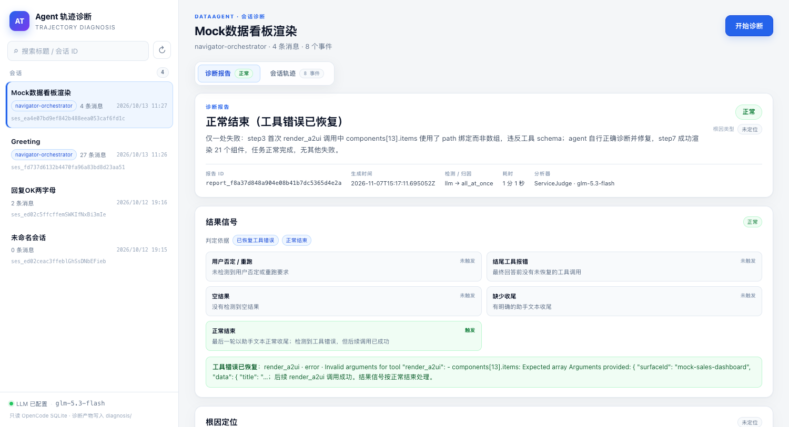
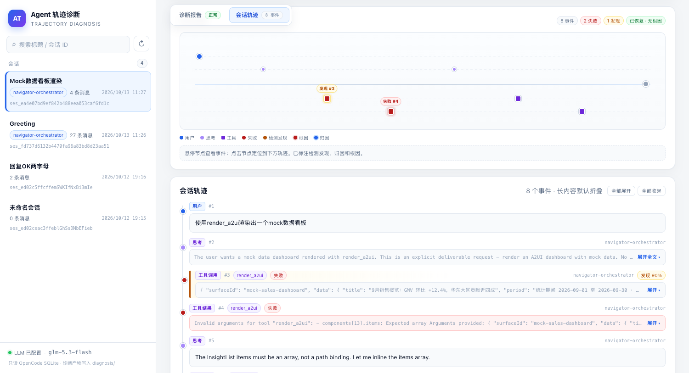

# Agent Trajectory Diagnosis

[中文](README.md) | [English](README.en.md)

**Local DataAgent / OpenCode 2 session diagnosis service**

Reads sessions from an OpenCode 2 SQLite store, converts a session into an
[AgentDebugX](https://github.com/AgentDebugX/AgentDebugX) trajectory, and runs
**outcome assessment → LLM failure detection → all-at-once attribution →
recovery suggestions**. The result is shown in a no-build, native HTML console
with a diagnosis report, trace map, and the full conversation trajectory.



## Features

- **Session browser**: reads OpenCode 2 `session_v2` / `session_message`
  directly, with filtering by title, session ID, slug, or agent.
- **One-click diagnosis**: `llm` detector + `all_at_once` attribution +
  Reflexion recovery suggestions, executed in the background and polled by the
  page.
- **Recovery-aware outcomes**: a tool error followed by a successful call
  before the final answer is treated as `normal`; the report says the tool
  error was recovered instead of labeling the recovered step as a final
  failure.
- **No root cause when attribution declines**: if attribution explicitly
  returns `no_failure`, the service does not force-select a step as the root
  cause, avoiding a "normal outcome but here is the root cause" contradiction.
- **Trace map**: failed nodes are red, findings amber, attribution blue, and
  the published root cause pulses red. Hover for details; click to jump to and
  flash the matching timeline entry.
- **Report / trajectory tabs**: a diagnosed session opens directly on the
  report, so you do not have to scroll past a long trajectory first. An
  undiagnosed session opens on the trajectory and its report tab shows a
  **Start diagnosis** placeholder.
- **Local-first**: the SQLite store is opened read-only; session payloads are
  never persisted. Only trajectory, report, and brief artifacts are written.



## Quick start

### 1. Install

Python 3.12 is recommended (the lifecycle script expects a repo-local
`.venv`):

```bash
python3.12 -m venv .venv
.venv/bin/pip install -e '.[ui]'
```

Or with uv:

```bash
uv venv --python 3.12 .venv
uv pip install -e '.[ui]'
```

The service needs at least `pydantic`, `httpx`, `fastapi`, and `uvicorn`; the
`[ui]` extra adds the last two.

### 2. Configure model credentials

The startup script reads LLM credentials from the following file by default
(**do not commit it**):

```
~/develop/dataagent/.local-dev/config/local.env
```

Create it:

```bash
mkdir -p ~/develop/dataagent/.local-dev/config
cat > ~/develop/dataagent/.local-dev/config/local.env <<'EOF'
# Root URL of an OpenAI-compatible endpoint; the client appends
# /chat/completions automatically.
GTS_LLM_BASE_URL=https://your-llm-gateway.example.com/v1
GTS_LLM_API_KEY=sk-replace-with-your-key

# Optional; defaults to deepseek-flash
AGENTDEBUG_LLM_MODEL=deepseek-flash
EOF
```

If the dataagent checkout is not at `~/develop/dataagent`, point
`DATAAGENT_HOME` or `DATAAGENT_ENV_FILE` at the real location. You can also
skip the dataagent file entirely and export
`AGENTDEBUG_LLM_BASE_URL` / `AGENTDEBUG_LLM_API_KEY` /
`AGENTDEBUG_LLM_MODEL` directly.

Without usable credentials, `/healthz` reports `llm_configured: false`,
diagnosis submissions return `503`, and session browsing still works.

### 3. Start

```bash
scripts/local-diagnosis-service.sh start
```

Open the console: <http://127.0.0.1:7777/>

Lifecycle commands:

```bash
scripts/local-diagnosis-service.sh status
scripts/local-diagnosis-service.sh logs
scripts/local-diagnosis-service.sh restart
scripts/local-diagnosis-service.sh stop
```

Run it directly without the script:

```bash
set -a; . ~/develop/dataagent/.local-dev/config/local.env; set +a
export AGENTDEBUG_LLM_BASE_URL="${AGENTDEBUG_LLM_BASE_URL:-${GTS_LLM_BASE_URL:-}}"
export AGENTDEBUG_LLM_API_KEY="${AGENTDEBUG_LLM_API_KEY:-${GTS_LLM_API_KEY:-}}"
export OPENCODE_DB=~/develop/dataagent/.local-dev/runtime/opencode.db
.venv/bin/python -m agentdebug.api
```

## Usage

1. Pick a session in the left sidebar. It opens on **Session trajectory**:
   overview, trace map, and timeline.
2. Click **Start diagnosis** in the upper-right corner. The service runs
   outcome assessment, LLM detection, attribution, and recovery suggestions.
3. When diagnosis completes, the page switches to **Diagnosis report**, which
   shows outcome signals, root-cause localization, findings, attribution,
   recovery proposals, and the Chinese brief.
4. Reopening a diagnosed session lands on the report tab. Switch to
   **Session trajectory** to see failures, findings, attribution, and the root
   cause marked on the timeline.

`?session=<session_id>` deep-links to a session.

## HTTP API

| Method | Path | Description |
| --- | --- | --- |
| `GET` | `/api/v1/sessions` | Session list, newest `time_updated` first; supports `limit` (1–500) |
| `GET` | `/api/v1/sessions/{id}` | Session metadata plus the converted trajectory |
| `POST` | `/api/v1/diagnose` | Submit a diagnosis; body: `{"session_id": "...", "detector": "llm", "attributor": "all_at_once"}` |
| `GET` | `/api/v1/diagnose/{id}` | Poll diagnosis state: `processing` / `done` / `failed` |
| `GET` | `/healthz` | Health, database path, model, and LLM configuration state |
| `GET` | `/` | Native HTML console |

Diagnosis and session routes are also registered under
`/api/agentdebug/api/v1/...` for gateway forwarding; the console is served
under the `/api/agentdebug` prefix as well.

## Configuration

| Variable | Meaning | Default |
| --- | --- | --- |
| `OPENCODE_DB` | OpenCode SQLite path | `~/.dataagent/opencode.db` |
| `DIAGNOSIS_OUT_DIR` | Artifact directory | `<repo>/diagnosis` |
| `AGENTDEBUG_LLM_BASE_URL` / `_API_KEY` / `_MODEL` | LLM used for detection and attribution | none / none / `deepseek-flash` |
| `AGENTDEBUG_LLM_TIMEOUT` | Per-request timeout (seconds) | `180` |
| `AGENTDEBUG_MIN_CONFIDENCE` | Minimum confidence for publishing a root cause | `0.5` |
| `AGENTDEBUG_LANGUAGE` | `zh` service prompts / `en` upstream prompts | `zh` |
| `DIAGNOSIS_HOST` / `DIAGNOSIS_PORT` | Listen address and port | `127.0.0.1` / `7777` |
| `DATAAGENT_HOME` | dataagent checkout | `~/develop/dataagent` |
| `DATAAGENT_ENV_FILE` | Model credentials file | `$DATAAGENT_HOME/.local-dev/config/local.env` |

## Artifacts

A completed diagnosis writes the following files under `diagnosis/`
(git-ignored):

```
diagnosis/session_<id>_trajectory.json
diagnosis/session_<id>_report.json
diagnosis/session_<id>_brief.md
```

Session payloads are not written to the artifact directory.

## Tests

```bash
.venv/bin/pytest -q \
  tests/test_api_outcome.py \
  tests/test_api_service_pipeline.py \
  tests/test_api_data_taxonomy.py \
  tests/test_api_ui.py \
  tests/test_api_diagnosis_service.py
```

## Documentation

- [Full local diagnosis service notes](docs/local-diagnosis-service.md):
  pipeline, P2–P4 behavior, endpoints, environment variables, and fidelity
  notes.
- [Trace schema](docs/TRACE_SCHEMA.md)
- [Architecture](docs/ARCHITECTURE.md)

## Upstream and license

This service builds on the trajectory, detection, attribution, and reporting
models of [AgentDebugX](https://github.com/AgentDebugX/AgentDebugX). The full
upstream framework documentation, CLI, papers, and citation information are
preserved in [README.upstream.md](README.upstream.md).

License: MIT, see [LICENSE](LICENSE).
