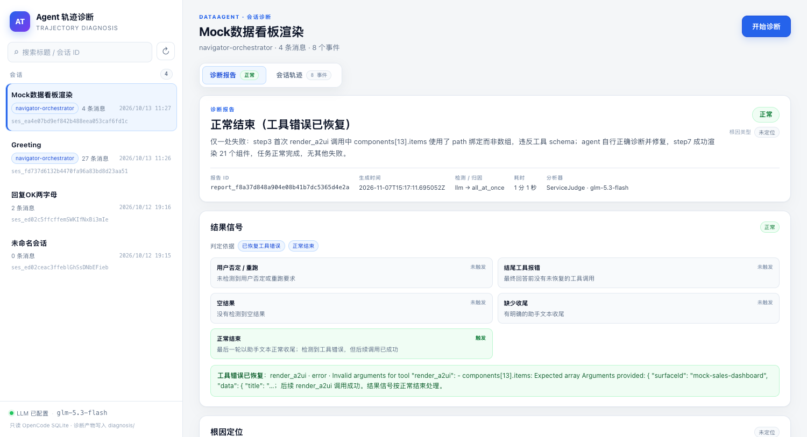
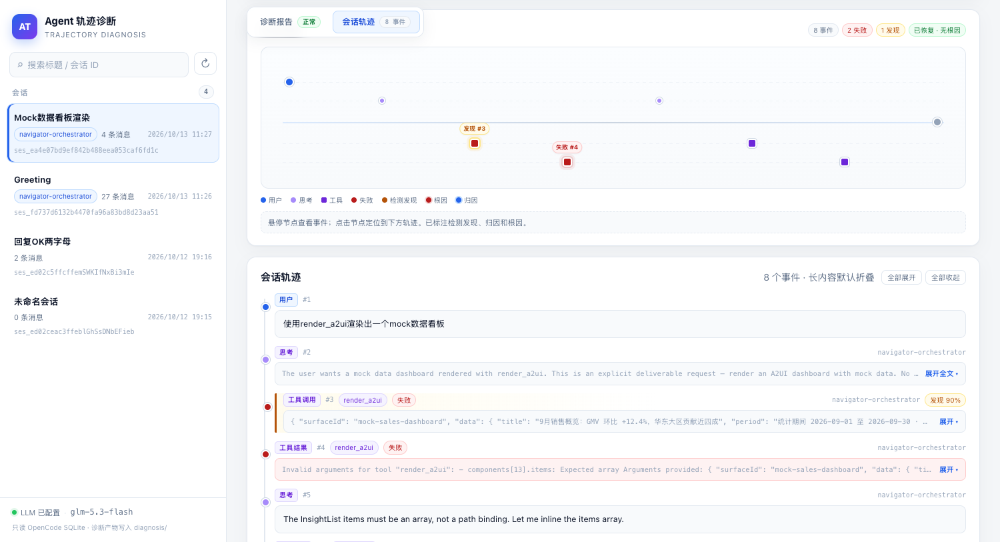

# Agent 轨迹诊断

[中文](README.md) | [English](README.en.md)

**本地 DataAgent / OpenCode 2 会话诊断服务**

读取 OpenCode 2 的 SQLite 会话库，把一次会话转换成
[AgentDebugX](https://github.com/AgentDebugX/AgentDebugX) 轨迹，依次执行
**结果判定 → LLM 失败检测 → all-at-once 归因 → 恢复建议**，并在一个无需构建的
原生 HTML 控制台中展示诊断报告、轨迹地图和完整会话轨迹。



## 功能

- **会话浏览**：直接读取 OpenCode 2 的 `session_v2` / `session_message`，
  支持按标题、会话 ID、slug、agent 过滤。
- **一键诊断**：`llm` 检测器 + `all_at_once` 归因 + Reflexion 恢复建议，
  后台执行，页面轮询进度。
- **恢复感知的结果判定**：工具报错后、在最终回答前又成功恢复的，判定为
  `normal`，报告会写明“工具错误已恢复”，不会把已经恢复的步骤当成最终失败。
- **归因否决时不出根因**：当归因明确返回 `no_failure` 时，不再强行选一个
  步骤作为根因，避免“说正常、又指根因”的矛盾。
- **轨迹地图**：失败节点标红，检测发现标琥珀色，归因标蓝，根因用红色脉冲
  高亮；悬停查看详情，点击跳转并闪烁对应时间线。
- **诊断报告 / 会话轨迹双标签**：已诊断会话直接打开报告，不必先滚过很长的
  轨迹；未诊断会话打开轨迹，报告标签页展示“开始诊断”占位页。
- **本地优先**：只读打开 SQLite，会话原文不落盘；只写轨迹、报告和简报
  三类诊断产物。



## 快速开始

### 1. 安装

需要 Python 3.12（脚本默认使用仓库下的 `.venv`）：

```bash
python3.12 -m venv .venv
.venv/bin/pip install -e '.[ui]'
```

或者使用 uv：

```bash
uv venv --python 3.12 .venv
uv pip install -e '.[ui]'
```

运行本服务至少需要 `pydantic`、`httpx`、`fastapi`、`uvicorn`；`[ui]` extra
会带上后两个。

### 2. 配置模型凭据

启动脚本默认从下面这个文件读取 LLM 配置（该文件**不入库**）：

```
~/develop/dataagent/.local-dev/config/local.env
```

创建它：

```bash
mkdir -p ~/develop/dataagent/.local-dev/config
cat > ~/develop/dataagent/.local-dev/config/local.env <<'EOF'
# OpenAI 兼容接口的根地址；客户端会自动追加 /chat/completions
GTS_LLM_BASE_URL=https://your-llm-gateway.example.com/v1
GTS_LLM_API_KEY=sk-replace-with-your-key

# 可选，默认 deepseek-flash
AGENTDEBUG_LLM_MODEL=deepseek-flash
EOF
```

如果 dataagent 不在 `~/develop/dataagent`，用 `DATAAGENT_HOME` 或
`DATAAGENT_ENV_FILE` 指向实际位置。也可以跳过 dataagent 配置文件，直接导出
`AGENTDEBUG_LLM_BASE_URL` / `AGENTDEBUG_LLM_API_KEY` /
`AGENTDEBUG_LLM_MODEL`。

没有可用凭据时，`/healthz` 会显示 `llm_configured: false`，诊断提交返回
`503`，但会话浏览仍然可用。

### 3. 启动

```bash
scripts/local-diagnosis-service.sh start
```

打开控制台：<http://127.0.0.1:7777/>

常用生命周期命令：

```bash
scripts/local-diagnosis-service.sh status
scripts/local-diagnosis-service.sh logs
scripts/local-diagnosis-service.sh restart
scripts/local-diagnosis-service.sh stop
```

直接启动（不使用脚本）：

```bash
set -a; . ~/develop/dataagent/.local-dev/config/local.env; set +a
export AGENTDEBUG_LLM_BASE_URL="${AGENTDEBUG_LLM_BASE_URL:-${GTS_LLM_BASE_URL:-}}"
export AGENTDEBUG_LLM_API_KEY="${AGENTDEBUG_LLM_API_KEY:-${GTS_LLM_API_KEY:-}}"
export OPENCODE_DB=~/develop/dataagent/.local-dev/runtime/opencode.db
.venv/bin/python -m agentdebug.api
```

## 使用

1. 左侧选择一条会话，默认展示**会话轨迹**：会话概览、轨迹地图、时间线。
2. 点击右上角**开始诊断**，服务依次执行结果判定、LLM 检测、归因和恢复建议。
3. 诊断完成后自动切到**诊断报告**，展示结果信号、根因定位、检测发现、
   归因结论、恢复建议和中文简报。
4. 之后重新打开这条已诊断会话，会直接停在报告页；切到**会话轨迹**可以看
   失败节点、检测发现、归因和根因在轨迹上的位置。

`?session=<session_id>` 可以直接深链到某条会话。

## HTTP API

| 方法 | 路径 | 说明 |
| --- | --- | --- |
| `GET` | `/api/v1/sessions` | 会话列表，按 `time_updated` 倒序，支持 `limit`（1–500） |
| `GET` | `/api/v1/sessions/{id}` | 会话元数据 + 转换后的轨迹 |
| `POST` | `/api/v1/diagnose` | 提交诊断，body：`{"session_id": "...", "detector": "llm", "attributor": "all_at_once"}` |
| `GET` | `/api/v1/diagnose/{id}` | 轮询诊断状态：`processing` / `done` / `failed` |
| `GET` | `/healthz` | 健康状态、数据库路径、模型与 LLM 配置状态 |
| `GET` | `/` | 原生 HTML 控制台 |

诊断和会话接口同时注册在 `/api/agentdebug/api/v1/...` 下，方便经过网关
转发；控制台也支持 `/api/agentdebug` 前缀。

## 配置项

| 变量 | 说明 | 默认值 |
| --- | --- | --- |
| `OPENCODE_DB` | OpenCode SQLite 路径 | `~/.dataagent/opencode.db` |
| `DIAGNOSIS_OUT_DIR` | 诊断产物目录 | `<repo>/diagnosis` |
| `AGENTDEBUG_LLM_BASE_URL` / `_API_KEY` / `_MODEL` | 检测与归因使用的 LLM | 无 / 无 / `deepseek-flash` |
| `AGENTDEBUG_LLM_TIMEOUT` | 单次模型请求超时（秒） | `180` |
| `AGENTDEBUG_MIN_CONFIDENCE` | 根因发布的最低置信度 | `0.5` |
| `AGENTDEBUG_LANGUAGE` | `zh` 服务提示词 / `en` 上游提示词 | `zh` |
| `DIAGNOSIS_HOST` / `DIAGNOSIS_PORT` | 监听地址与端口 | `127.0.0.1` / `7777` |
| `DATAAGENT_HOME` | dataagent 代码目录 | `~/develop/dataagent` |
| `DATAAGENT_ENV_FILE` | 模型凭据文件 | `$DATAAGENT_HOME/.local-dev/config/local.env` |

## 产物

诊断完成后写入 `diagnosis/`（已 gitignore）：

```
diagnosis/session_<id>_trajectory.json
diagnosis/session_<id>_report.json
diagnosis/session_<id>_brief.md
```

会话原文不会写入产物目录。

## 测试

```bash
.venv/bin/pytest -q \
  tests/test_api_outcome.py \
  tests/test_api_service_pipeline.py \
  tests/test_api_data_taxonomy.py \
  tests/test_api_ui.py \
  tests/test_api_diagnosis_service.py
```

## 文档

- [本地诊断服务完整说明](docs/local-diagnosis-service.md)：pipeline、P2–P4
  行为、接口、环境变量和保真说明。
- [轨迹 schema](docs/TRACE_SCHEMA.md)
- [架构说明](docs/ARCHITECTURE.md)

## 上游与许可

本服务基于 [AgentDebugX](https://github.com/AgentDebugX/AgentDebugX)
的轨迹、检测、归因和报告模型构建。上游完整的框架说明、CLI、论文与引用
信息保留在 [README.upstream.md](README.upstream.md)。

License: MIT，见 [LICENSE](LICENSE)。
